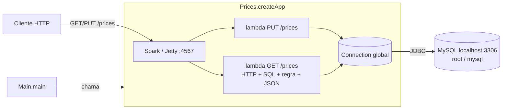
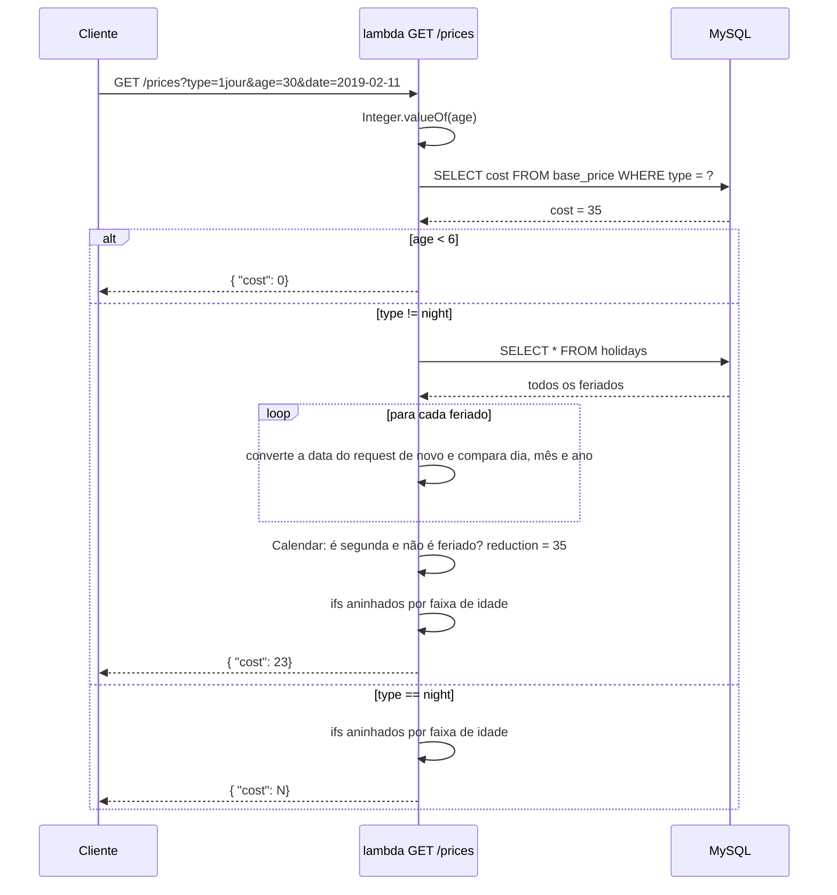
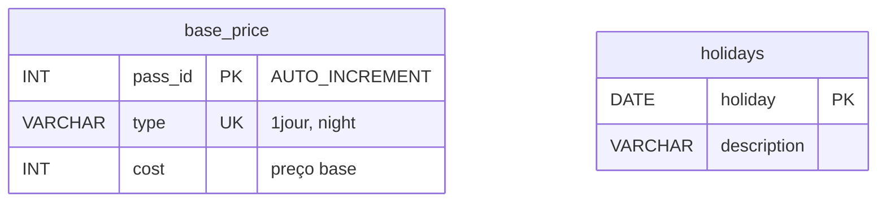

# Engenharia reversa (Etapa 2)

Este documento descreve o sistema como ele está na tag `v0-original`, ou seja, antes de qualquer mudança nossa. As referências de linha são dessa versão. Como o projeto não tinha documentação, tudo aqui foi recuperado lendo o código e executando a API.

## Arquitetura atual

O sistema tem uma camada só. A classe `Prices` cria a conexão com o banco, configura o servidor HTTP e registra as rotas, e cada rota é uma lambda que lê os parâmetros, executa SQL, aplica a regra de preço e monta a resposta. Não existe separação entre a parte HTTP, a regra de negócio e o acesso a dados.

## Componentes e responsabilidades

| Componente | Responsabilidades | Linhas |
|---|---|---|
| `Main` | Registra o driver do MySQL, chama `Prices.createApp()`, imprime a URL de exemplo e fecha a conexão ao encerrar | 28 |
| `Prices.createApp()` | Abre a conexão JDBC, define a porta, registra as duas rotas e o filtro que define o `Content-Type` | 130 (a classe inteira) |
| lambda `PUT /prices` | Lê `type` e `cost` e faz `INSERT ... ON DUPLICATE KEY UPDATE` | 15 (linhas 26 a 40) |
| lambda `GET /prices` | Lê `type`, `age` e `date`, busca o preço base, busca todos os feriados, decide o desconto, calcula o preço e monta o JSON | 80 (linhas 42 a 121) |
| filtro `after` | Define `Content-Type: application/json` em todas as respostas | 3 |
| `PricesTest` | Sobe a aplicação e faz um `GET /prices` sem parâmetros esperando `"putSomethingHere"` | 48 |

## Fluxo do `GET /prices`

Um detalhe do fluxo: o preço base é consultado antes de verificar a idade, mas só é lido (`result.getInt("cost")`) depois. Por isso, `GET /prices?type=vip&age=5` responde `{ "cost": 0}` mesmo com um tipo que não existe, enquanto `type=vip&age=30` dá erro 500.

## Modelo de dados

As duas tabelas não se relacionam. A coluna `pass_id` não é usada pelo código; a busca é sempre pelo `type`, que é único. A coluna `description` dos feriados também não é lida.

## Dependências externas

| Dependência | Para que serve | Observação |
|---|---|---|
| MySQL em `localhost:3306` | Guarda preços e feriados | URL, usuário e senha fixos em `Prices.java` |
| Spark Java 2.7.2 | Servidor HTTP e rotas | API estática (`spark.Spark.get`, `port` etc.), com estado global |
| Jetty (via Spark) | Servidor embutido | Porta 4567 fixa |
| `mysql-connector-java` | Driver JDBC | Carregado por `Class.forName` em `Main` |
| slf4j-simple | Log | Nível `warn` em `simplelogger.properties` |
| JUnit 5 e REST Assured | Testes | Só usados no teste de exemplo |

## Requisitos recuperados do código

### Funcionais

| Código | Requisito |
|---|---|
| RF01 | Informar o preço de um passe a partir do tipo, da idade (opcional) e da data (opcional). |
| RF02 | Cadastrar um tipo de passe novo ou alterar o preço base de um tipo existente. |
| RF03 | Não cobrar de quem tem menos de 6 anos, em qualquer tipo de passe. |
| RF04 | No passe diurno, dar 35% de desconto às segundas-feiras que não são feriado, exceto para menores de 15 anos. |
| RF05 | No passe diurno, cobrar 70% do preço de quem tem de 6 a 14 anos e 75% de quem tem mais de 64. |
| RF06 | No passe noturno, cobrar 40% de quem tem mais de 64 anos e o preço cheio de quem tem de 6 a 64. Sem idade informada, o passe noturno sai de graça. |
| RF07 | Arredondar o preço final para cima. |
| RF08 | Tratar como passe diurno qualquer tipo cadastrado que não seja `night`. |

### Não funcionais

| Código | Requisito | Situação no legado |
|---|---|---|
| RNF01 | Responder em JSON | Atendido com concatenação de texto; nas respostas de erro vem HTML |
| RNF02 | Persistir preços e feriados em banco relacional | Atendido, mas preso a um MySQL configurado de um jeito específico |
| RNF03 | Atender requisições concorrentes | Arriscado: uma única `Connection` é compartilhada por todas as threads do Jetty |
| RNF04 | Tratar entradas inválidas | Não atendido: qualquer parâmetro errado vira erro 500 |
| RNF05 | Ser testável | Não atendido: só é possível testar subindo servidor e banco juntos |
| RNF06 | Ser fácil de instalar e executar | Não atendido: exige instalar e configurar um MySQL antes |
